<div align="center">

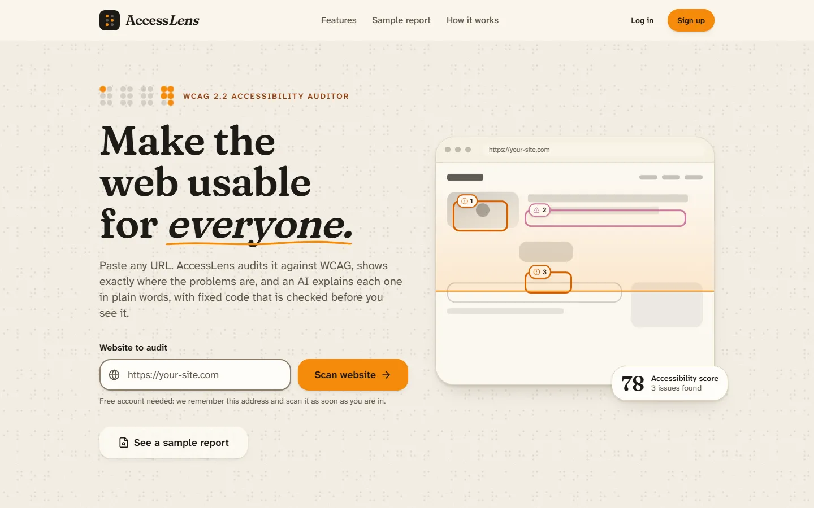

# AccessLens

**An AI website accessibility auditor. Paste a URL, see exactly who your site locks out, and get fixes that are checked before you see them.**

     
   

**[Live demo](LIVE_URL)** · **[Sample report (no login)](LIVE_URL/sample)** · Demo login: `demo@accesslens.dev` / `AccessLens-Demo-2026`

</div>

> AccessLens is a portfolio project: a full-stack product built end to end (scanner, queue, AI pipeline, report UI, PDF, sharing, trends) with security and accessibility treated as features, not afterthoughts.

---

## Why AccessLens

The web is still mostly inaccessible, and the people who pay for it are not a niche:

- **94.8%** of the one million most popular home pages had detectable WCAG 2 failures, and **79.1%** had text with too little colour contrast, the most common failure. ([WebAIM Million, 2025](https://webaim.org/projects/million/))
- About **1.3 billion people, 1 in 6 worldwide**, live with a significant disability. ([World Health Organization](https://www.who.int/news-room/fact-sheets/detail/disability-and-health))
- **2.2 billion** people have some form of vision impairment. ([WHO World report on vision, 2019](https://www.who.int/publications/i/item/9789241516570))

Most accessibility tools stop at a list of rule IDs. AccessLens goes further: it shows *where* each problem is on the page, explains it in plain English, writes the fix, **re-checks the fix with axe-core**, and lets you test the page the way a keyboard user or a colour-blind visitor experiences it.

## Features

### Score, report and issue map

A 0-100 score with a documented formula, issues grouped by rule, severity, WCAG principle and level, and a full-page screenshot with numbered markers. Severity is shown by colour *and* icon *and* pattern *and* word (the palette is validated for colour-blind separation).

<p>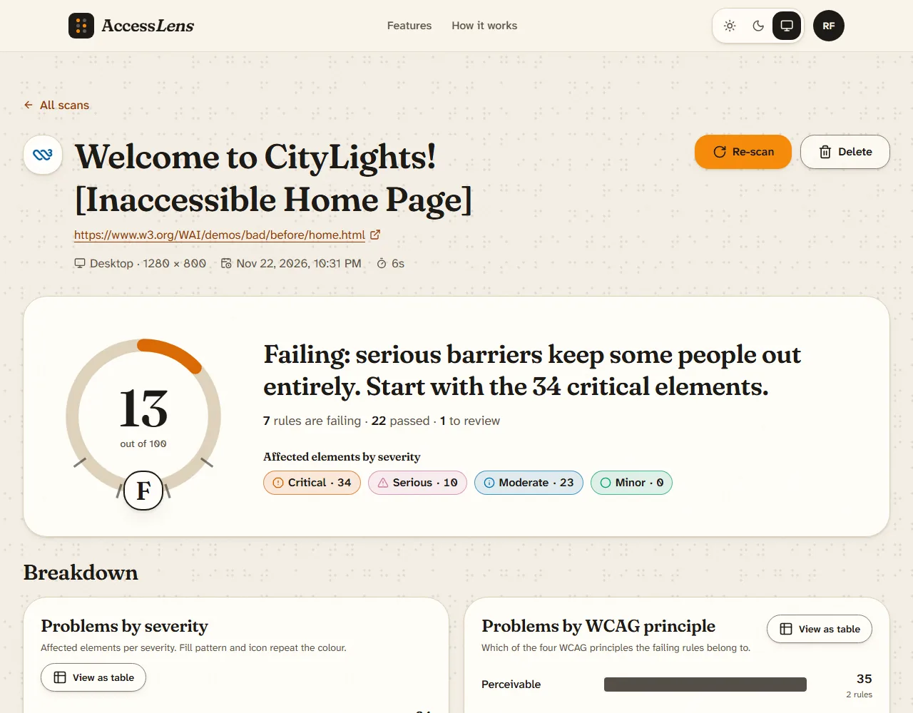 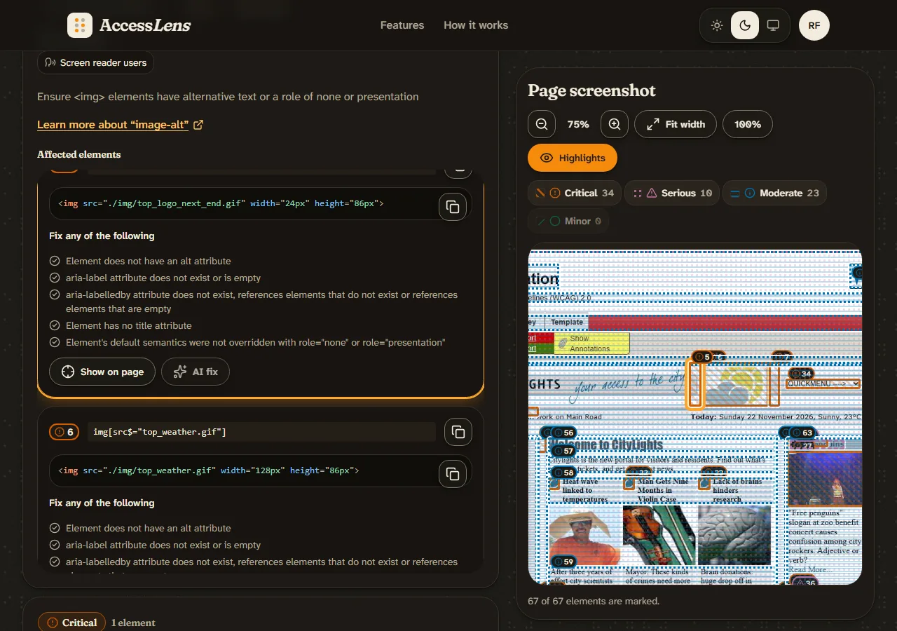</p>

### AI fixes, verified

For each element: a plain-English explanation, the smallest HTML change that fixes it, CSS and React versions, test steps, and WCAG criteria. The fix is then **re-run through axe-core in an isolated, offline browser** and labelled *Verified fix*, *Not verified* or *Needs page context*. If the first attempt fails the re-check, a stronger model gets a second try. Without a key, on timeout, or when rate limited you get clearly labelled *guided fixes* from built-in rules, so the app never breaks.

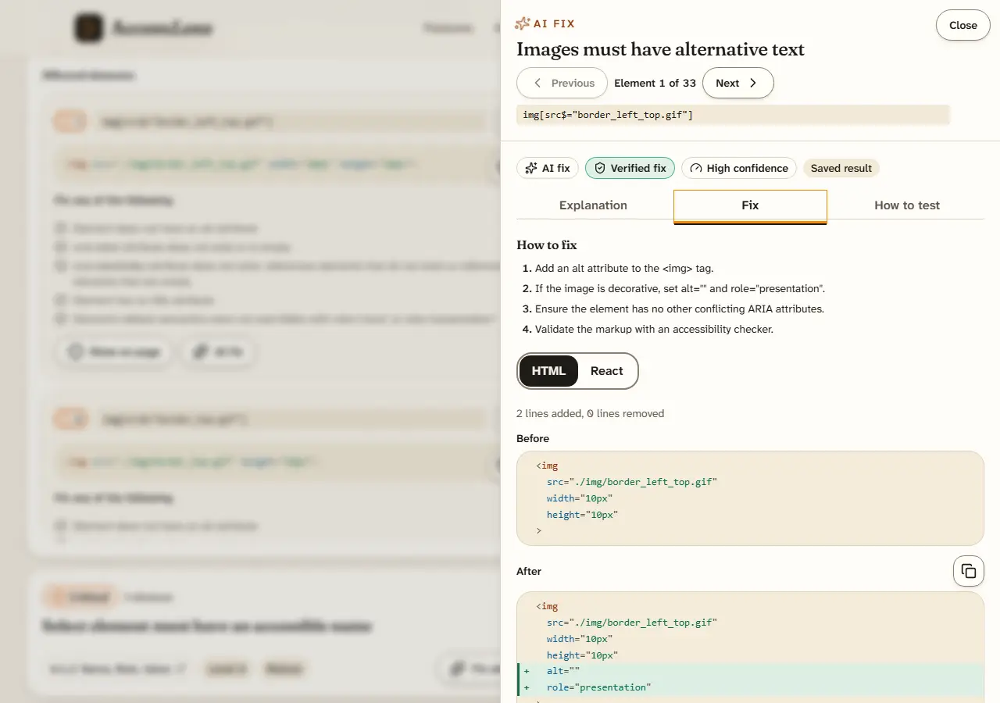

### Contrast fixed by maths, not guesses

For colour-contrast failures the real WCAG ratio is calculated and the nearest accessible colours are computed algorithmically. The AI only explains the result; it never picks a colour.

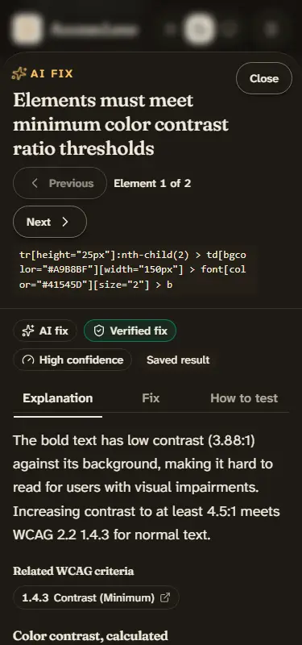

### Vision simulator

Protanopia, deuteranopia, tritanopia (Machado et al. 2009 matrices), achromatopsia, low-vision blur and cataract-like haze, as SVG filters in your browser (zero server cost), with slider and side-by-side comparison. There is a live demo on the landing page.

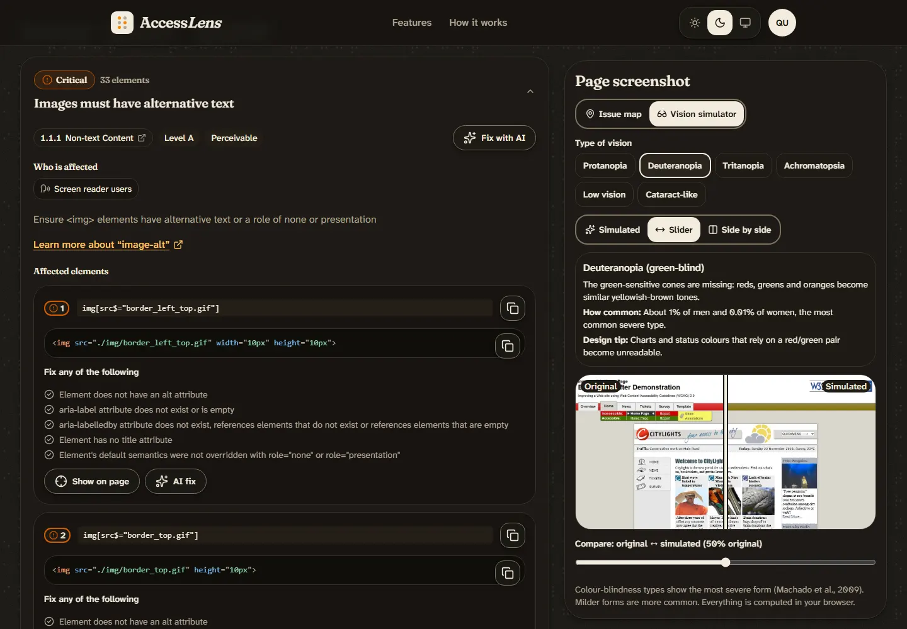

### Keyboard tab-order map

During the scan, AccessLens presses Tab through the page and draws the path on the screenshot. It finds keyboard traps, invisible focus, off-screen focus, big focus jumps, links that throw focus away (`onfocus="blur()"`), and clickable elements Tab can never reach. On a slow site you get a clearly labelled partial map instead of a failed scan.

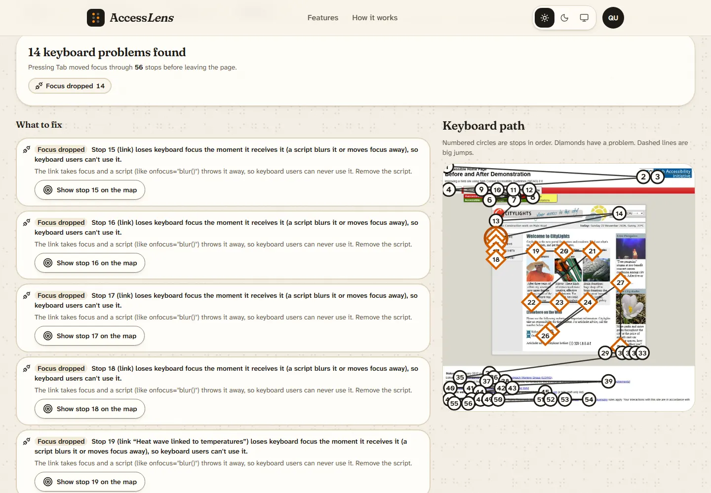

### PDF report

A branded, **tagged** PDF (real text, headings, bookmarks, document language) with executive summary, breakdowns, top issues with fixes, keyboard summary, annotated screenshot and a full rule appendix. It is rendered with JavaScript off and every network request blocked, uses saved AI fixes only (no AI call), and is cached per scan until a fix or summary changes.

### Share links

Read-only links with a 256-bit random token (only its hash is stored), optional expiry (24 h / 7 d / 30 d / never), an option to hide the screenshot, instant revoke, a QR code and an embeddable score badge.

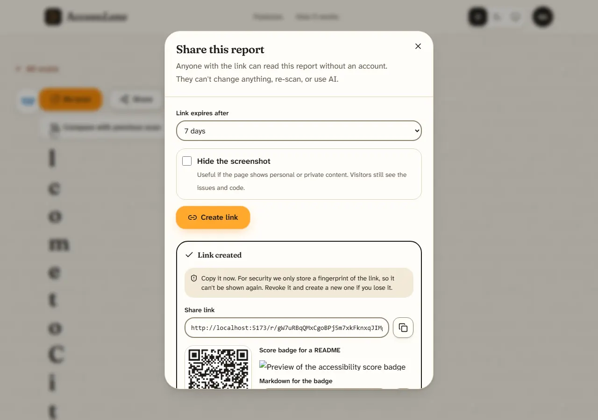

### Compare scans and track trends

Issues are matched across scans by fingerprint (rule + normalised selector + markup hash, with moved/changed/fuzzy fallbacks): *Fixed*, *New*, *Still present*. Per-site score trend with an accessible data table. Export issues as CSV or JSON.

<p>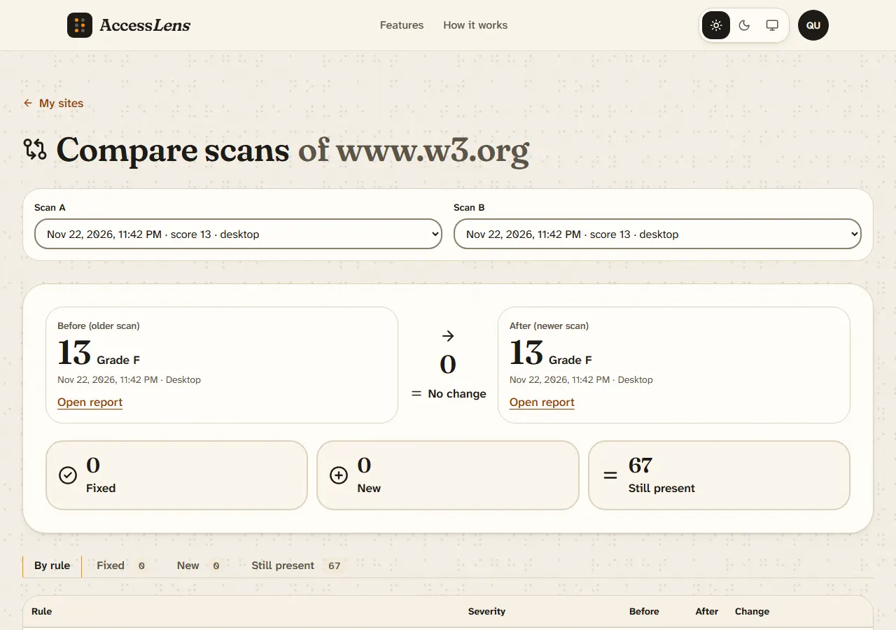 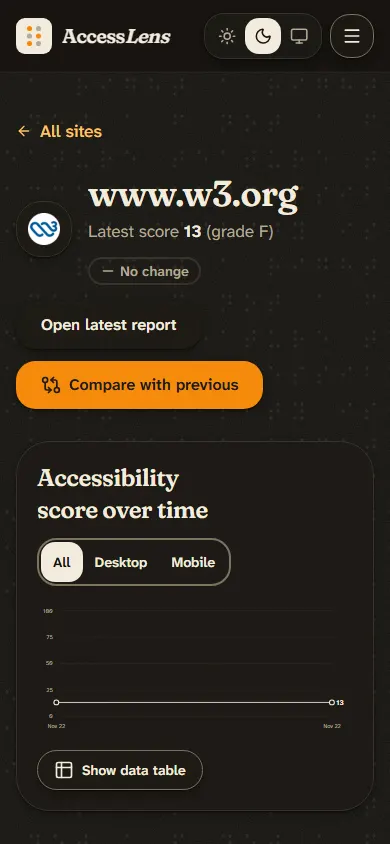</p>

### Dashboard

Stats, sites with sparklines, most common issues across all scans, collapsible sidebar (mobile drawer), and a one-click sample scan for new users.

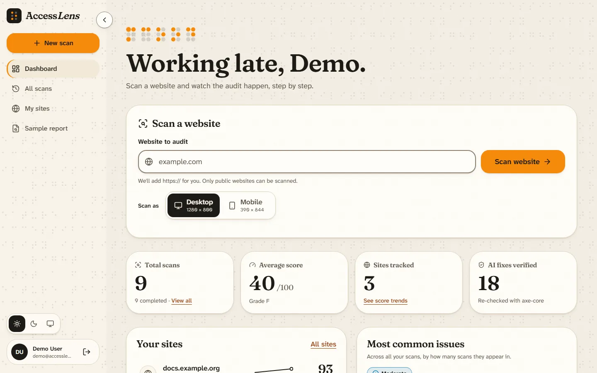

---

## Architecture

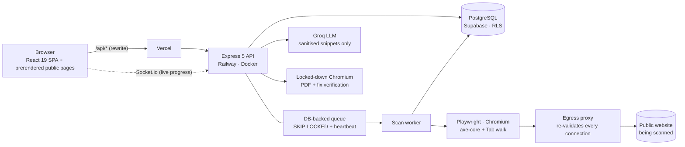

- **Queue in Postgres:** scans are claimed with `FOR UPDATE SKIP LOCKED`, heartbeats detect crashed workers, and a graceful shutdown hands running scans back to the queue.
- **One browser, many isolated contexts:** a scan gets a fresh context behind its own egress proxy; PDF and fix verification use separate, network-less contexts.
- **Static where possible:** the public pages are prerendered at build time and hydrated; the signed-in app is a normal SPA.

### How a scan works

1. The URL is normalised and checked (scheme, port, credentials, IP literals) before it is queued.
2. A worker claims the scan, resolves DNS and refuses private ranges, then loads the page in a fresh Chromium context whose **every** connection goes through the egress proxy.
3. axe-core runs against WCAG 2.2 A/AA plus best practices; element boxes are measured; a full-page screenshot is taken.
4. The worker presses **Tab** up to 100 times (8 s budget) and records the focus path, visibility of focus, traps and unreachable controls.
5. Score, per-rule totals, issues, screenshot and keyboard map are stored in one transaction. Progress streams to the browser over Socket.io (polling as fallback).

### How AI fixes are verified

1. The failing element's HTML is **sanitised** (scripts, handlers, input values, tokens in URLs and `data:` URIs removed; truncated) and sent to the model **as JSON data**, never inside instructions.
2. The reply must be strict JSON that passes a zod schema and contains no scripts, handlers or remote resources; one corrective retry, then a guided fix.
3. Original and fixed snippets are loaded into an isolated, offline Chromium context (CSP `default-src 'none'`, all requests aborted) and the **single axe rule** is run on both.
4. *Verified* = fails before, passes after. *Not verified* triggers one retry with the stronger model, shown the axe failure. *Needs page context* = page-level rules that can't be judged on a snippet.
5. Results are cached by `hash(rule + normalised HTML + failure summary + model + prompt version)` and shared across users, so nothing is paid for twice.

---

## Security

| Area | What is done |
|---|---|
| **SSRF** | Every connection from the scanner (redirect hops, sub-resources, iframes) goes through a local **egress proxy** that re-resolves and re-validates the target, so DNS rebinding and redirects to internal addresses fail. Private ranges, loopback, link-local/metadata addresses, odd ports and credentials in URLs are refused; WebSockets are blocked. |
| **Prompt injection** | Scanned HTML is untrusted: sanitised, truncated and sent only as a JSON string value; the system prompt tells the model to ignore instructions inside the data; replies are schema-validated and refused if they contain scripts or handlers; AI text is never rendered as HTML, and links in it work only for `w3.org` / `deque.com`. |
| **Auth** | bcrypt, short-lived access tokens in memory, single-use rotating refresh tokens in an HTTP-only cookie (hashed at rest), reuse detection, origin check on state-changing requests, rate limits. |
| **Share links** | 256-bit random token, **only the SHA-256 is stored**, constant 404 for wrong / expired / revoked tokens, no owner data in public payloads, `noindex` + `no-referrer`, per-IP rate limits, public API is read-only and can never trigger AI. |
| **Exports** | CSV cells that start with `=`, `+`, `-`, `@` are neutralised (formula injection); PDFs are generated with JavaScript disabled and no network. |
| **Database** | **Row Level Security enabled on every table with no policies** and anon/authenticated grants revoked, so Supabase's public API can read nothing; a test fails if any table lacks RLS. Tests refuse to run against a non-local database. |
| **Browser** | Strict CSP (`script-src 'self'`, no inline scripts), `frame-ancestors 'none'`, `X-Content-Type-Options`, `Referrer-Policy`, `Permissions-Policy`. |
| **Secrets** | `.env` files are git-ignored; the logger redacts keys; no snippet or AI reply is ever logged. |

## Accessibility

AccessLens is itself held to WCAG 2.2 AA:

- **axe-core: 0 violations** on 32 page states in the final pass (landing, features, privacy, sample report, login, dashboard, history, report × 375 / 1280 px × light / dark), plus earlier passes on every phase's states (AI panel, vision simulator, keyboard tab, share dialog, compare, trends, public share page), and **no horizontal overflow** at 375, 768, 1280 and 1536 px.
- **Colour-blind safe palette:** severity never relies on colour alone (icon, pattern and word as well), validated for adjacent-pair separation in both themes.
- **Keyboard first:** skip link, roving focus in the screenshot markers, focus-managed dialogs and sheets, visible 3 px focus rings, `aria-live` regions that announce results (not every streamed token), diffs marked with `+` / `−` and spoken labels.
- **Motion respects people:** reduced-motion users get the same animations at lower intensity, never a static page (verified on every page); the marquee has a real pause button.

## Testing

| Suite | Result |
|---|---|
| Server (unit, API, integration, end to end) | **289 passing**: scanner, SSRF, egress proxy, scoring, tab-order recorder (traps, invisible focus, slow pages), AI pipeline with a mocked LLM (invalid JSON, timeouts, 429, prompt injection, cache, verification), contrast maths, share-link security, PDF (no network), compare matching, exports, dashboard, RLS, and a real-browser **signed-out URL → sign-up → automatic scan** flow |
| Client | **9 passing**: colour-blindness matrices (published values), safe-link rules, diff |
| axe-core | **0 violations**, 32 page states in the final pass (see above) |
| Lighthouse, landing, **desktop** | Performance **99**, Accessibility **100**, Best practices **100**, SEO **100** (median of 3) |
| Lighthouse, landing, **mobile** (throttled) | Performance **74** (median of 3), Accessibility 100, Best practices 100, SEO 100; LCP 3.7 s, CLS 0 |
| Lighthouse, sample report, mobile | Performance **63** (median of 3), Accessibility 100, Best practices 100, SEO 100; CLS 0 |

Mobile performance is measured on a compressed static server with Lighthouse's default 4× CPU / slow-4G throttling. Public pages are prerendered, so the first paint is fast (observed ~0.6 s unthrottled); the remaining cost is JavaScript for hydration and animation. Live numbers from the deployed site go here once it is up.

Run them yourself: see [Scripts](#scripts).

## Tech stack

| Layer | Technology |
|---|---|
| Frontend | React 19, Vite, TypeScript, Tailwind v4, shadcn/ui (Base UI), Framer Motion, GSAP ScrollTrigger, TanStack Query + Virtual, Prism (lazy) |
| Backend | Node 22, Express 5, TypeScript, zod, Socket.io, Prisma 7 (pg adapter) |
| Scanning | Playwright (Chromium), axe-core, custom egress proxy |
| AI | Groq (`gpt-oss-20b` / `gpt-oss-120b`), strict JSON schemas, SSE streaming |
| Data | PostgreSQL on Supabase (RLS), DB-backed job queue |
| Deploy | Railway (Docker, slim Chromium image), Vercel (static + rewrite), prerendered public routes |
| Quality | `node:test`, Playwright E2E, axe-core, Lighthouse |

## Local setup

Requirements: Node 22+, Docker.

```bash
git clone https://github.com/ASHUTOSH-KUMAR-RAO/ai-accessibility-auditor.git
cd ai-accessibility-auditor

# 1. database (local Postgres on :5455)
docker compose up -d

# 2. server
cd server
cp .env.example .env            # then fill in the two JWT secrets (command in the file) and optionally GROQ_API_KEY
npm install
npm run playwright:install      # downloads Chromium once
npm run prisma:deploy           # applies migrations
npm run seed:demo               # optional: demo account with scans, trends and cached AI fixes
npm run dev                     # API + scan worker on :4000

# 3. client (second terminal)
cd client
cp .env.example .env
npm install
npm run dev                     # http://localhost:5173
```

Without `GROQ_API_KEY` everything works; you get guided fixes instead of AI fixes.

### Environment variables

Names and meaning only. Never commit real values.

**`server/.env`**

| Variable | Purpose |
|---|---|
| `DATABASE_URL`, `DIRECT_URL` | Pooled runtime connection and direct/session connection for migrations |
| `TEST_DATABASE_URL`, `TEST_DIRECT_URL` | **Local** database the tests use (tests refuse anything that is not localhost) |
| `CLIENT_URL` | Allowed browser origin(s), comma-separated (CORS + CSRF origin check) |
| `JWT_ACCESS_SECRET`, `JWT_REFRESH_SECRET` | Token signing secrets (≥ 32 chars, must differ) |
| `JWT_ACCESS_EXPIRES`, `JWT_REFRESH_EXPIRES_DAYS`, `COOKIE_SAMESITE`, `TRUST_PROXY` | Session and proxy behaviour |
| `GROQ_API_KEY`, `GROQ_MODEL_FAST`, `GROQ_MODEL_SMART`, `AI_TIMEOUT_MS` | AI provider and models |
| `AI_RATE_LIMIT_PER_HOUR`, `AI_MAX_CONCURRENT` | Per-user AI budget and parallel calls |
| `SCAN_WORKER_ENABLED`, `SCAN_CONCURRENCY`, `SCAN_RATE_LIMIT_PER_HOUR`, `SCAN_MAX_ACTIVE_PER_USER` | Scan engine and limits |
| `SCAN_NAV_TIMEOUT_MS`, `SCAN_TOTAL_TIMEOUT_MS`, `SCAN_MAX_PAGE_BYTES` | Scan safety limits |
| `DB_POOL_MAX` | Database connections per instance |

**`client/.env`**

| Variable | Purpose |
|---|---|
| `VITE_API_URL` | API base (`/api`: proxied in dev, rewritten in production) |
| `VITE_SOCKET_URL` | Socket.io origin (empty in dev; the API origin in production) |
| `VITE_SITE_URL` | Public origin for canonical links, Open Graph, sitemap and robots |

### Scripts

| Where | Command | What it does |
|---|---|---|
| server | `npm run dev` | API + worker with reload |
| server | `npm test` | all server tests (needs the local Docker DB; the client must be built for the E2E test) |
| server | `npm run prisma:deploy` | apply migrations |
| server | `npm run seed:demo` | create/reset the demo account (`--force` required in production) |
| server | `npm run sample:export -- <scanId>` | freeze a scan into the static sample report |
| client | `npm run dev` | Vite dev server |
| client | `npm run build` | typecheck, build, SSR build, prerender public pages |
| client | `npm test` | client unit tests |
| client | `npm run lint` | oxlint |

### Project structure

```text
.
├── client/                    React app
│   ├── public/demo/           static sample report (JSON + screenshot)
│   ├── scripts/prerender.mjs  build step: prerender public routes
│   ├── vercel.json            rewrites, CSP and cache headers
│   └── src/
│       ├── components/        landing, report, ai, layout, dashboard, ui (shadcn)
│       ├── lib/               API client, hooks, vision matrices, SEO, diff
│       └── pages/             route components
├── server/
│   ├── prisma/                schema + migrations (incl. RLS)
│   ├── scripts/               seed-demo, export-sample, brand assets
│   └── src/
│       ├── services/scanner/  Playwright + axe + egress proxy + tab-order recorder
│       ├── services/ai/       LLM client, prompts, sanitiser, contrast maths, verifier
│       ├── services/{pdf,share,compare,export,report}/
│       ├── controllers/ routes/ middlewares/
│       └── *.test.ts          unit, API and E2E tests
├── docs/                      DEPLOY.md, SMOKE_TEST.md, screenshots
└── docker-compose.yml         local Postgres
```

## Deployment

Railway (API + scan worker, Docker with Chromium) and Vercel (frontend), database on Supabase. Step-by-step click path, every environment variable and the order of steps are in **[docs/DEPLOY.md](docs/DEPLOY.md)**; a checklist to verify the live app is in **[docs/SMOKE_TEST.md](docs/SMOKE_TEST.md)**.

## What this project shows

- Designed and built a full-stack accessibility auditor end to end: Playwright + axe-core scanner behind an SSRF-hardened egress proxy, Postgres-backed job queue with crash recovery, real-time progress over Socket.io, and a report UI with a screenshot issue map.
- Built an LLM pipeline that **verifies its own output**: sanitised snippets as data (prompt-injection defence), strict JSON schemas, and an automatic axe-core re-check in an isolated offline browser that labels every fix *Verified*, *Not verified* or *Needs page context*, with a deterministic fallback so AI failure never breaks the app; shared cache across users.
- Shipped features most audit tools lack: keyboard tab-order map with trap and invisible-focus detection, colour-blindness simulator, tagged PDF reports, expiring share links (hashed tokens), issue-level scan comparison and score trends.
- Hardened and tested for production: Row Level Security on every table, CSP with no inline scripts, **289 server tests** including a real-browser sign-up-to-scan flow, **0 axe-core violations** on 32 page states in light and dark at 375 and 1280 px, Lighthouse 99/100/100/100 on desktop.
- Cut first-paint cost by prerendering public routes (hydrated, SEO tags in the HTML), moving animations to the compositor, splitting heavy libraries, and reserving layout space (CLS 0); documented the remaining mobile performance gap honestly.

---

<div align="center">Made by Avishka</div>
